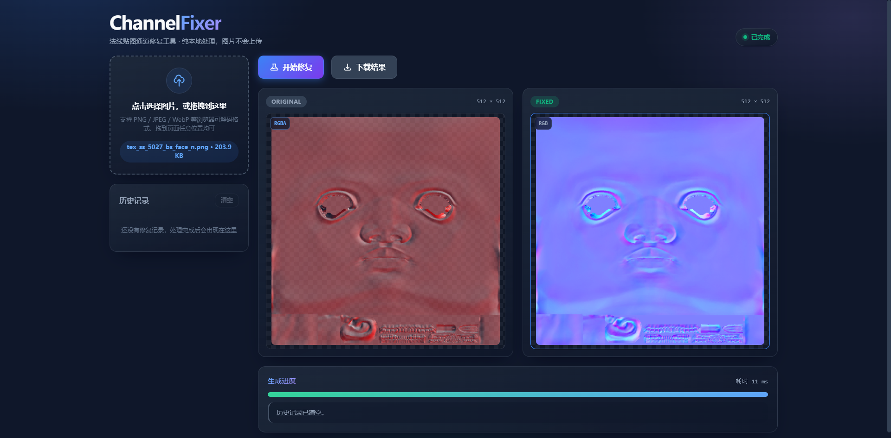

# ChannelFixer · 法线贴图通道修复工具

一个轻量、纯前端的图片通道编辑器，专为法线贴图等通道重排场景设计。支持本地图片拖拽预览与一键修复，无需安装后端服务或第三方依赖。


## 功能特性
- 支持本地图片选择与拖拽导入，**拖到页面任意位置**均可导入，且不会触发浏览器直接打开图片
- 预览区并排展示“原图”和“修复后”两张卡片，点击可**在页面内浮层**按原尺寸放大查看（不依赖弹窗，不会被拦截）
- 预览浮层内可**单独查看任意通道**：合成视图或 `R` / `G` / `B` / `A` 单通道，支持灰度与 RGB 着色两种呈现方式，原图与修复结果都适用
- 通道修复逻辑：
  - 绿色通道黑白翻转（`G = 255 - G`）
  - 透明通道拷贝到红通道（`R = A`）
  - 红通道拷贝到蓝通道（`B = R`）
  - 丢弃原图蓝通道，并将透明通道设为不透明（`A = 255`）
- 左侧历史记录带缩略图、名称、分辨率与时间戳，支持单条下载、单条移除与“清空”
- 每个预览框左上角显示通道信息徽标：原图自动识别 `RGB/RGBA`，修复结果为 `RGB`
- 页面内可见的状态区（就绪 / 处理中 / 完成 / 警告 / 失败）与真实进度条，处理与导出都有明确反馈
- 响应式布局：宽屏双栏、中屏收窄侧栏、窄屏单列堆叠（上传 → 控制 → 预览 → 进度 → 历史）
- 纯前端实现，无后端依赖，图片不会上传到任何服务器

## 在线预览
本项目为纯静态网页，推荐通过任意静态服务器打开（可获得后台线程处理能力）。例如：
```
python -m http.server 8000
```
启动后访问：
```
http://localhost:8000/
```
如果 IPv6 地址不可用，请使用上述 IPv4 地址而非 `http://[::]:8000/`。

也可以直接双击 `index.html` 以 `file://` 方式打开，功能完全可用；区别在于：

| 运行方式 | 处理执行 | 说明 |
| --- | --- | --- |
| 静态服务器（http/https） | Web Worker 后台线程 | 界面在处理大图时保持顺滑 |
| 直接打开（`file://`） | 主线程分片 + 请求动画帧 | 浏览器会拦截 `file://` 下的 Worker/模块加载，页面自动降级 |

页面会在降级时提示“已自动切换为主线程处理”，无需手动配置。

## 使用指南
1. 打开页面后，点击上传区域或将图片拖到页面任意位置
2. 主区并排显示原图与修复后卡片，左上角显示通道信息；若输入不含透明通道会有明确提醒
3. 点击“开始修复”，进度条与状态区会实时反映处理进度与耗时
4. 处理完成后点击“下载结果”保存为 PNG；左侧历史记录中可单独下载、移除或整体清空
5. 点击任一预览图可在页内浮层查看原尺寸，按 `Esc` 或点击遮罩关闭
6. 在浮层内用通道切换条查看单通道：`合成` / `R` / `G` / `B` / `A`，并可在“灰度”与“RGB 着色”之间切换

## 单通道预览
排查法线贴图问题时，最难判断的往往不是“图长什么样”，而是“某个通道里到底有什么”。浮层内的通道切换条把这件事变成一次点击：

| 视图 | 用途 |
| --- | --- |
| `合成` | 彩色原貌，用于确认整体观感 |
| `R` / `G` / `B` | 查看单个颜色通道的灰度分布，快速定位脏数据、接缝、烘焙残留 |
| `A` | 查看透明通道。对本工具而言这是关键通道——修复时红通道正是取自它 |
| 灰度 / RGB 着色 | 灰度适合读数值；RGB 着色把通道涂成对应原色，适合快速确认“这张图缺的是哪个通道” |

几点说明：
- **通道值一律按不透明渲染。** 预览画布衬在棋盘格底色上，若保留原 alpha，半透明区域的灰度会被底色混合，读到的数不等于真实通道值。
- **“RGB 着色”只对单通道有意义。** 它没有对应的 A 通道原色，因此在 `A` 上等同于灰度；在`合成`视图下点击会提示该模式不生效。
- **切换不改变修复逻辑，也不会影响下载结果。** 它只是读取已完成的结果，不重新计算通道映射。
- 大图切换通道会分片执行，界面保持可响应，浮层右下角会显示本次提取耗时。

## 支持格式
- 浏览器原生可解码的图片格式：`PNG`, `JPEG`, `WebP`, `GIF`, `BMP`, `AVIF`
- `TGA`：由内置的 WebAssembly 解码器处理，覆盖未压缩与 RLE 压缩、24/32 位真彩色、15/16 位（5-5-5）、8 位灰度与灰度+alpha、色表索引（8/16 位索引，15/16/24/32 位表项）
- `DDS`：同样由 WebAssembly 解码器处理，覆盖未压缩 `R8G8B8A8` / `B8G8R8A8` 与 `BC1` / `BC2` / `BC3` / `BC4` / `BC5` / `BC7` 块压缩；只读最顶层 mip 与第一张面
- `EXR` / `HDR` / `PSD` 等仍不支持解码的格式会被明确拒绝，并提示先转换为 PNG 或 JPEG
- 处理上限：单张图片像素总量约 3355 万（≈ 8192 × 4096），单文件 150MB；超限会给出可读提示而非卡死

## 使用须知
- 修复是**不可逆**的通道重排：当输入不含透明通道（例如普通 JPEG/PNG）时，红通道会被整体置为 255，原红通道信息将丢失。页面在载入此类图片时会给出警告。
- 结果统一导出为 PNG，因此透明通道信息（`A = 255`）不会被 JPEG 压缩破坏。
- **关于半透明像素的精度**：`TGA` 由 wasm 解码，处理时直接使用解码出的原始像素，通道值精确。`PNG` / `JPEG` 等浏览器原生解码的格式拿不到原始像素——浏览器在解码和画布存取时会对半透明像素做一次预乘往返，`alpha=200` 时通道值 `30` 会被读成 `31`，`alpha=1` 时 `17` 会被读成 `0`。实测 WebCodecs 的 `ImageDecoder` 与画布给出完全相同的结果，说明损失发生在浏览器的解码管线内部，应用层无法绕过。对精度敏感时，可以先把图片另存为 TGA 再导入。

## 技术栈
- 原生 `HTML/CSS/JavaScript`（经典脚本，无构建步骤、无 npm 依赖）
- 使用 `Canvas 2D` 进行逐像素处理与预览
- 使用 `Web Worker` 承担逐像素计算，配合 `Transferable` 零拷贝传输；不可用时自动降级为主线程分片
- 导出使用 `canvas.toBlob` + `URL.createObjectURL`，不产生 base64 体积膨胀
- `TGA` 由 Rust 编译的 `WebAssembly` 解码器处理，仅在真的导入 TGA 时才加载
- 字体使用本地优先字体栈（`Inter` / `system-ui` / `PingFang SC` / `Microsoft YaHei`），**无任何外部请求**，离线可用

### 逐像素处理为什么按 32 位读写

通道映射本质是纯内存搬运：每个像素读出 RGBA、重排、写回。逐字节写法每个像素要做 4 次读 + 4 次写，字级写法各做 1 次。在 8192×4096 的图上实测，映射快约 1.8 倍。

这里没有黑科技，只是把四次零散访问合并成一次连续访问。单通道提取同理：把「是否着色」的判断从循环里挪到循环外，灰度与着色各走一条无分支循环，实测快约 2.4 倍。

字级路径依赖三个前提，任一不满足就自动退回逐字节实现，结果完全相同：

- 机器是小端序（大端下通道位序是反的）
- 缓冲按 4 字节对齐（否则无法构造 32 位视图）
- 缓冲长度足以覆盖要处理的行（否则越界读出的 `undefined` 在两条路径上会被转换成不同字节）

逐字节实现保留在 `algorithm.js` 中，它同时承担两个职责：降级路径，以及等价测试的对照物。`test/algorithm-parity.test.js` 里另有一份照本文档规则独立写出的参考实现，用来确认快路径没有改变任何输出。

### TGA / DDS 为什么用 WebAssembly 而不是手写 JS

浏览器的图片解码 API 两种都不支持。手写解析器要覆盖的组合非常多——TGA 有未压缩与 RLE、8/16/24/32 位色深、灰度、色表索引、原点翻转；DDS 更麻烦，它是容器格式，里面可能是未压缩像素，也可能是 BC1–BC7 块压缩。每一条都可能藏 bug，而这类 bug 表现为「图能显示但数值不对」，比直接报错更难发现。

所以改用 Rust 生态里成熟的解码器，编译成 wasm（约 105 KB，两种格式共用一个模块）。它只在用户真的导入 `.tga` / `.dds` 时才加载，普通 PNG 用户不会为它付出任何下载成本。

DDS 特意没有用 `image` crate 自带的实现：那个只支持 DXT1/3/5 且不支持未压缩 DDS，而法线贴图最常用的恰恰是 BC5 与未压缩 RGBA8。

**为什么不用 wasm 加速逐像素处理**：实测 Rust 纯计算确实比 JS 快，但真实路径要把整幅图拷进 wasm 线性内存再拷出来，8K 图就是 256MB 搬运，总耗时只快约 8%。瓶颈在内存带宽，不在计算，不值得为此引入构建链。wasm 用在这里是因为「浏览器不会做的事」必须有人做，不是因为「能做得更快」。

产物由 `crates/texture-decoder/` 编译而来，已随仓库提交，克隆下来无需安装 Rust 即可运行。需要重新编译时执行 `npm run build:wasm`（前置条件：`rustup target add wasm32-unknown-unknown`）。

## 项目结构
```
FixNormalMapChannel/
├── index.html        # 页面结构与 UI
├── style.css         # 深色科技风主题、响应式布局与动效
├── algorithm.js      # 算法层：通道映射、单通道提取与通道信息判定（无 DOM 依赖）
├── worker.js         # 执行层：后台线程分片计算
├── script.js         # 交互层：状态机、任务调度、历史记录、导出
├── texture-decoder.js    # 解码层：wasm 加载与数据搬运（file:// 下走内联 base64）
├── vendor/           # wasm 产物（已编译入库，克隆即用）
├── crates/texture-decoder/  # wasm 解码器的 Rust 源码
├── scripts/          # 静态服务器、冒烟检查、wasm 构建、DDS 兼容性验证
├── test/             # 单元测试、等价测试、wasm 集成测试、DOM 垫片
├── test/fixtures/dds/  # 真实 DDS 固件（texconv 生成，含参照展开结果）
├── tex_ss_5027_bs_face_n.png  # 示例法线贴图
├── FixNormalMapChannel.png    # README 配图
├── LICENSE
└── README.md
```

## 参与开发

> **给外部贡献者的重要说明**
>
> `main` 分支受保护，且仅维护者可直接推送。
> **请向 `dev` 分支提交 Pull Request；直接向 `main` 提交的 PR 大概率不会受理。**

推荐流程：

1. Fork 本仓库到你自己账号
2. 从 `dev` 分支切出特性分支（`git checkout -b feature/xxx`）
3. 提交改动并推送到你的 Fork
4. 向本仓库的 **`dev` 分支** 开 Pull Request，等待 CI 通过与合并

分支流向：`feature/xxx` → `dev`（日常集成）→ `main`（发布版本）

## CI

`.github/workflows/ci.yml`，触发条件为 PR 与 push 到 `main` / `dev`。四个 job：

| job | 内容 |
| --- | --- |
| `unit` | `npm test` + `npm run smoke` |
| `wasm` | `cargo test --locked`、重建 wasm 产物、校验产物与源码一致 |
| `security` | `cargo audit`、gitleaks 密钥扫描、前端零依赖断言 |
| `ci` | 聚合 job，唯一 required check |

`ci` 是分支保护登记的唯一检查名。job 改名时必须同步更新分支保护，否则 PR 会卡在缺失的检查上。

刻意**没有**用 `paths` 过滤：required workflow 一旦按路径过滤，只改文档的 PR 会永久卡在 `Expected — Waiting for status to be reported`。

## 发布

`.github/workflows/release.yml`，由 tag `v*` 触发，流程为：校验 tag 与 `package.json` 版本一致 → 打包静态站点 → 生成 `SHA256SUMS` → 上传 Release → 回读校验产物。

```
git tag -a v1.1.0 -m "..." && git push origin v1.1.0
```

tag 的版本号必须与 `package.json` 的 `version` 字段一致，否则 workflow 会失败——版本对不上时，用户下载到的包和他引用的版本不是同一个东西。

## 开发与部署
- 静态部署到任意静态托管平台（GitHub Pages、Netlify、Vercel 等）
- 或本地运行任意静态服务器（如 `http-server`, `python -m http.server`）
- 修改了 `crates/texture-decoder/` 之后需要重新编译产物：`npm run build:wasm`（前置条件 `rustup target add wasm32-unknown-unknown`）。产物已入库，普通开发不需要安装 Rust
- `npm run verify:dds`：用微软 texconv 重新生成各格式 DDS 并逐字节比对解码结果，需要本机装有 texconv（`--texconv` 指定路径）。CI 不跑它——CI 跑的是 `test/dds-fixtures.test.js`，直接读入库的固件，无需 texconv

## 后续规划
- `EXR` 等更多格式支持（可复用现有 wasm 通道，需评估 crate 体积）
- `DDS` 的 BC6H（HDR 半精度）与立方体贴图 / 纹理数组
- 批量处理与队列导出
- 键盘快捷键与完整的无障碍支持

## 许可
[MIT License](LICENSE)
